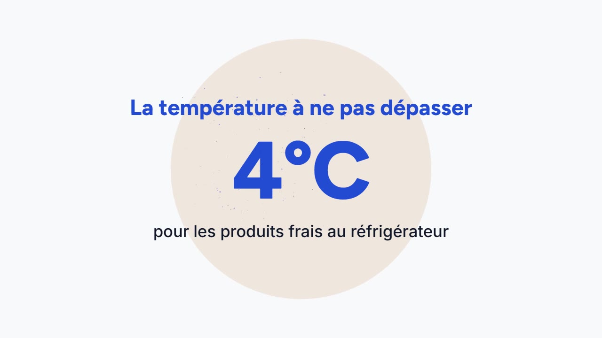

# Pulse Motion

*Version française : [README.md](README.md).*

Create dynamic motion design videos on your own computer, with no cloud service: describe your idea in plain words, approve the timeline, then watch the video in your browser.

> **Pulse Motion is made for French speakers.** The plugin, its questions, its messages and Claude's answers while it uses the plugin are in French. This English README and the [English wiki](https://jdelauney.github.io/pulse-motion/en/index.html) help you discover it; the requests shown as examples stay in French, with their translation alongside.

[](https://jdelauney.github.io/pulse-motion/medias/chaine-du-froid.mp4)

*Click the image to watch a video made with Pulse Motion, the one from the first tutorial: « la chaîne du froid pour mes stagiaires » (“the cold chain, for my trainees”).*

## In 5 minutes

1. **Install** the plugin (see below), then open an empty folder in Claude Code.
2. **Create**: `/pulse-motion:creer la chaîne du froid pour mes stagiaires` (“the cold chain, for my trainees”), answer the questions (the « Recommandé », Recommended, answers are fine), approve the timeline.
3. **Watch**: the video opens in your browser. An edit takes one sentence (`/pulse-motion:retoucher ralentis la scène 3`, “slow down scene 3”).
4. **Export**: `/pulse-motion:exporter` builds the MP4 on your computer.

Step by step: [Quick start](https://jdelauney.github.io/pulse-motion/en/demarrage-rapide.html), and the whole guide on the [wiki](https://jdelauney.github.io/pulse-motion/en/index.html).

More videos made with Pulse Motion, each with the sentence that started it and its timeline, plus two edits shown before and after: [Examples](https://jdelauney.github.io/pulse-motion/en/exemples.html).

This repository is a Claude Code plugin marketplace. It contains the [`pulse-motion`](plugins/pulse-motion/) plugin (its README is in French).

## Installation

In Claude Code:

```
/plugin marketplace add jdelauney/pulse-motion
/plugin install pulse-motion@pulse-motion
```

Close and restart Claude Code. Requirements: Node.js 20 or later, and Chrome or Edge ([step-by-step installation](https://jdelauney.github.io/pulse-motion/en/prerequis.html)).

## Contributing

The contributor guide, [CONTRIBUTING.en.md](CONTRIBUTING.en.md) ([en français](CONTRIBUTING.md)), explains how to set up the repository, run the tests and add a style, an effect, a move or a video template. [ARCHITECTURE.md](ARCHITECTURE.md) explains how a video is built (in French, with an English summary at the top).

## Licence

MIT – see [LICENSE](LICENSE).
